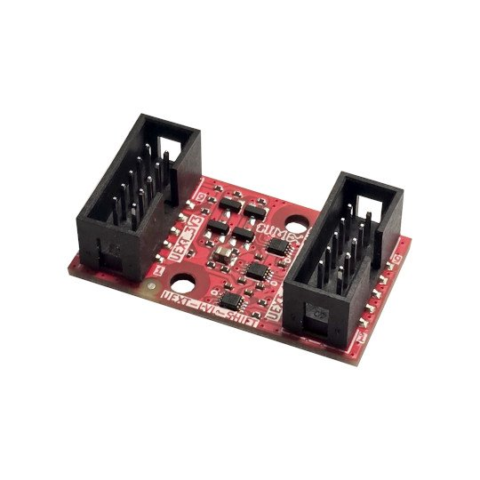

# UEXT-LVL-SHIFT
UEXT level shift module allow boards with UEXT connector to interface modules with voltage levels from 1.65V to 5.5V

https://www.olimex.com/Products/Modules/Adapters/UEXT-LVL-SHIFT/open-source-hardware

## Licensee
* Hardware is released under CERN Open Hardware Licence Version 2 - Strongly Reciprocal, all silkscreen credits to Bernardo Kastrup and Dean Belfield should remain;
* Software is released under MIT Licensee
* Documentation is released under CC BY-SA 3.0